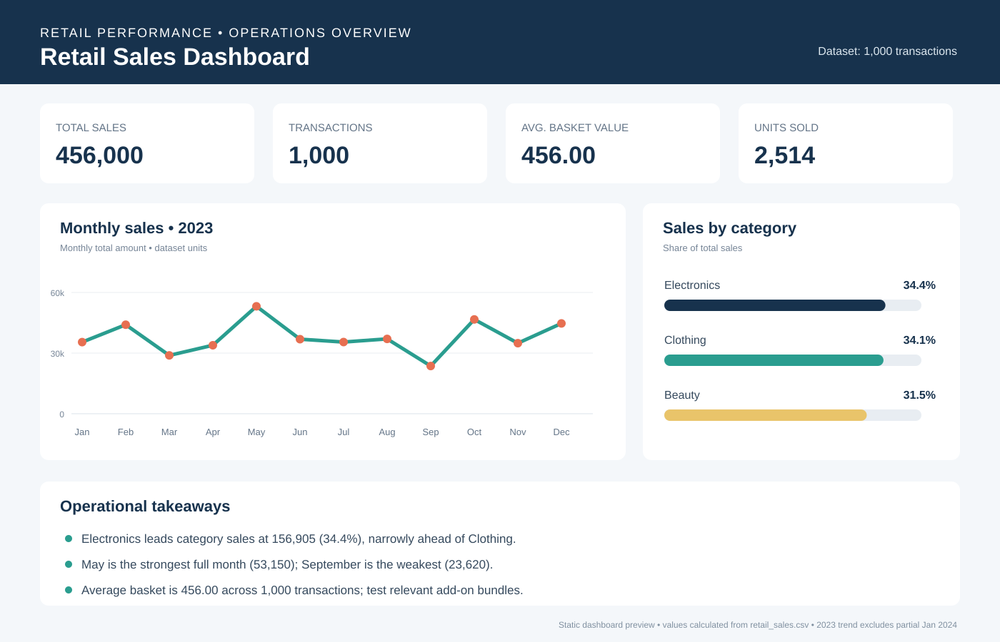

# Retail Sales Analysis



## Overview

An exploratory retail performance analysis using Python, SQL and a Power BI-ready reporting model. The project examines transaction value, category mix, monthly sales movement and customer demographics using the supplied 1,000-row dataset.

**Tools:** Python (pandas, matplotlib, seaborn), SQL (SQLite-compatible), Power BI (DAX measures and dashboard build guide).

## Dataset

- File: [`retail_sales.csv`](retail_sales.csv)
- Source: [Retail Sales Dataset on Kaggle](https://www.kaggle.com/datasets/mohammadtalib786/retail-sales-dataset)
- 1,000 transactions, 1,000 customer IDs, 9 columns.
- Fields: Transaction ID, Date, Customer ID, Gender, Age, Product Category, Quantity, Price per Unit, Total Amount.
- Dates run from 1 January 2023 to 1 January 2024.
- **Data caveat:** two transactions are dated 1 January 2024 (combined sales: 1,530). They are included in all-dataset KPIs, but the 2023 monthly trend and Jan-to-Dec growth comparisons exclude them. Amounts are shown in the dataset's units; no currency is specified in the source.

## Key findings

The figures below are calculated directly from the committed CSV.

| Metric | Result |
|---|---:|
| Transactions | 1,000 |
| Total sales (all rows) | 456,000 |
| Average transaction value | 456.00 |
| Units sold | 2,514 |
| Average units per transaction | 2.51 |
| Distinct customer IDs | 1,000 |

### Category performance

| Category | Sales | Share of sales | Transactions |
|---|---:|---:|---:|
| Electronics | 156,905 | 34.4% | 342 |
| Clothing | 155,580 | 34.1% | 351 |
| Beauty | 143,515 | 31.5% | 307 |

Electronics is the largest category by sales, but only narrowly: it leads Clothing by 1,325 (0.3 percentage points of total sales). Clothing generated the most transactions (351), while Electronics had the highest sales value.

### Monthly sales (2023)

| Month | Sales | Change vs previous month |
|---|---:|---:|
| Jan | 35,450 | — |
| Feb | 44,060 | +24.3% |
| Mar | 28,990 | -34.2% |
| Apr | 33,870 | +16.8% |
| May | 53,150 | +56.9% |
| Jun | 36,715 | -30.9% |
| Jul | 35,465 | -3.4% |
| Aug | 36,960 | +4.2% |
| Sep | 23,620 | -36.1% |
| Oct | 46,580 | +97.2% |
| Nov | 34,920 | -25.0% |
| Dec | 44,690 | +28.0% |

- May was the strongest month at 53,150; September was the weakest at 23,620.
- December sales were 26.1% higher than January 2023 (44,690 vs 35,450).
- The sharp October rebound (+97.2% month over month) followed September's low base; investigate campaign, stock and transaction-level drivers before treating it as a recurring seasonal pattern.
- The two January 2024 rows total 1,530 and are not a full month, so January 2024 should not be compared with full months.

## Business recommendations

1. **Protect the Electronics lead while testing margin-led promotions.** Electronics contributes 34.4% of sales, just ahead of Clothing. Review gross margin and stock availability before increasing promotions; sales value alone does not establish profitability.
2. **Plan inventory and labour around volatility.** May (53,150) and October (46,580) were strong, while September (23,620) was the low point. Check promotion calendars, footfall and stock-outs to understand the peaks, then use those drivers—not this single year's totals alone—to inform replenishment and rota planning.
3. **Lift basket value through measured cross-category offers.** Average transaction value is 456.00 and the average basket is 2.51 units. Test relevant add-on bundles and compare conversion, units per transaction and margin against a control group.

## Analysis and dashboard assets

- [Dashboard preview](images/retail_sales_dashboard.svg) — static visual summary calculated from the same CSV.
- [Python analysis](analysis.py) — generates the EDA charts in `images/`.
- [SQL business questions](sql/retail_sales_analysis.sql) — five reusable SQLite queries.
- [Power BI DAX measures](powerbi/measures.dax) — core measures for a Power BI model.
- [Power BI theme](powerbi/retail_theme.json) — optional report theme.
- [Power BI build guide](powerbi/README.md) — import steps, visual layout and refresh notes.

### Reproduce the Python analysis

```bash
pip install -r requirements.txt
python analysis.py
```

The script reads `retail_sales.csv` from the repository root and writes the charts to `images/`.

## Power BI

The repository contains a Power BI-ready dataset, DAX measures, theme and build instructions, plus a static dashboard preview. A native `.pbix` report must be assembled and saved in Power BI Desktop; the static preview is not a Power BI screenshot or an editable PBIX file.
